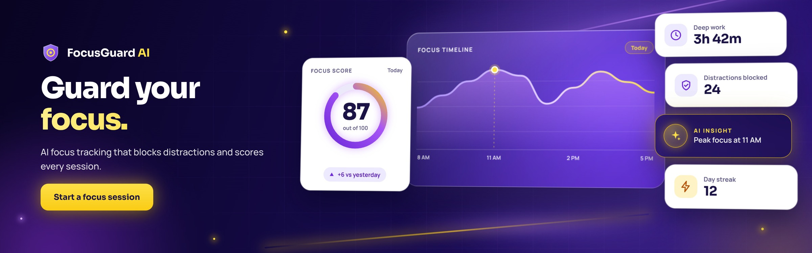
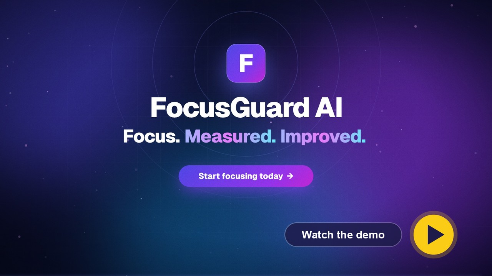
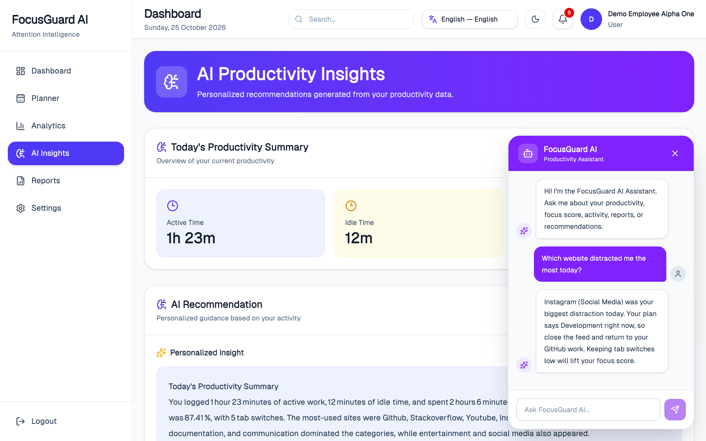
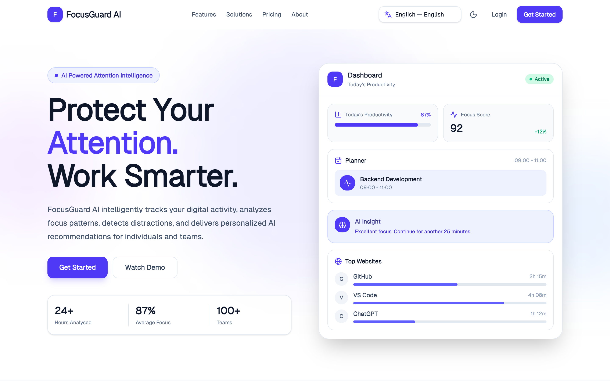
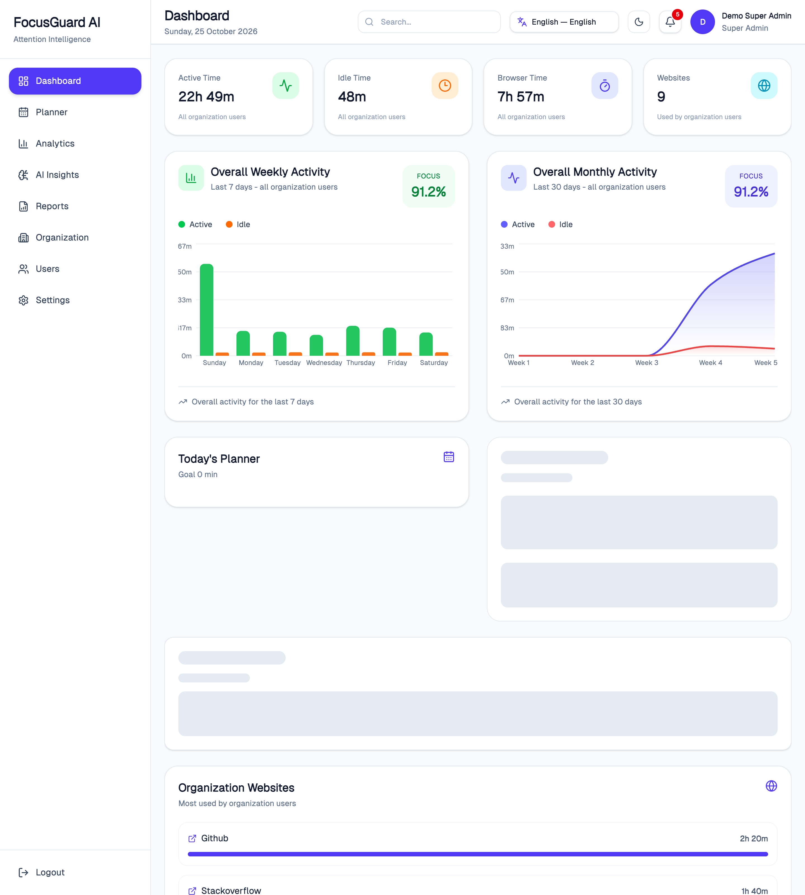
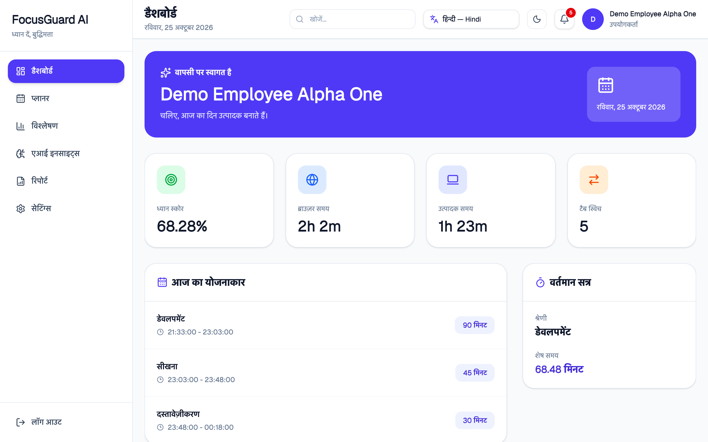
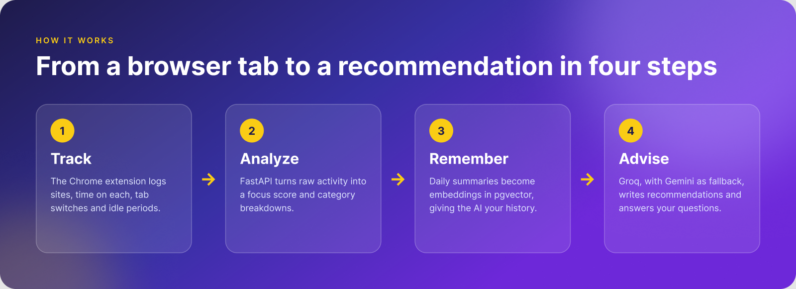
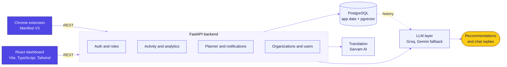
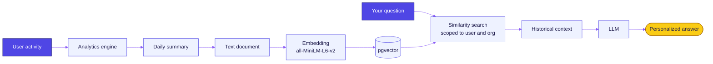
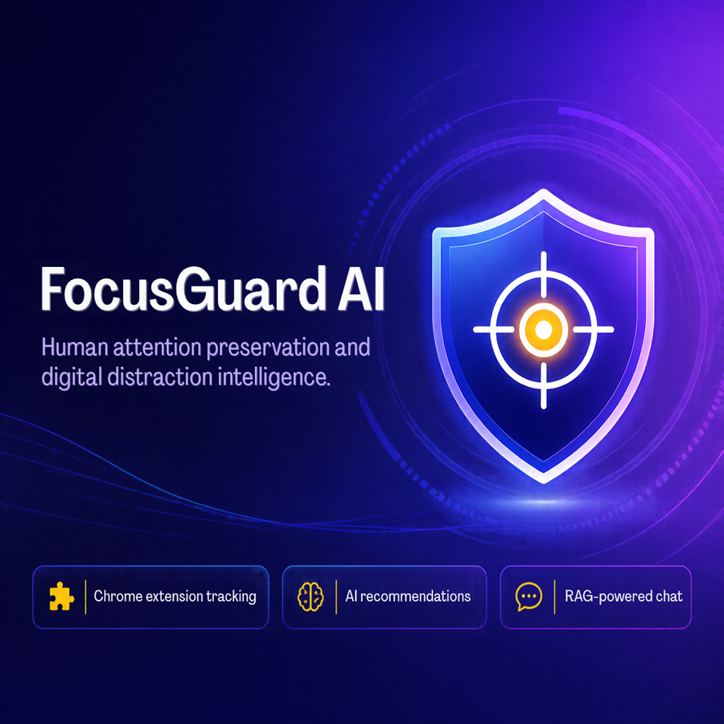

<div align="center">



<br><br>


<br>

<p>
  
  
  
  
  
  
  
</p>

<p>
  <a href="#see-it-in-action">Screens</a> &nbsp;·&nbsp;
  <a href="#what-it-does">Features</a> &nbsp;·&nbsp;
  <a href="#how-it-fits-together">Architecture</a> &nbsp;·&nbsp;
  <a href="#the-rag-pipeline">RAG</a> &nbsp;·&nbsp;
  <a href="#quick-start">Quick start</a> &nbsp;·&nbsp;
  <a href="#project-layout">Layout</a>
</p>

</div>


## Why FocusGuard AI

Most screen-time tools tell you how long you were online. FocusGuard AI compares what you planned to work on with what you are actually doing, scores the difference, and explains it in plain language.

A Chrome extension records browser activity: which sites you visit, how long, when you switch tabs, when you go idle. A FastAPI backend turns that into analytics, and an LLM turns the analytics into advice. Past days are stored as embeddings in PostgreSQL, so the advice can draw on your history and not only on today.

It works for individuals and for teams. Organizations, Sub Admins and Super Admins each see only the data their role allows.

<p align="center">
  <a href="https://buildwithabhinav-ai.github.io/focusguard-ai/docs/demo.html">
    
  </a>
  <br>
  <sub>Click the poster to watch the demo video.</sub>
</p>


## See it in action

<p align="center">
  <picture>
    <source media="(prefers-color-scheme: dark)" srcset="demo_video/shots/emp_dashboard_dark.png">
    
  </picture>
  &nbsp;
  
</p>

<p align="center">
  <sub>Left: the employee dashboard (it follows your GitHub theme). Right: AI insights and the chat assistant.</sub>
</p>

<details>
<summary><b>More screens</b></summary>
<br>

| Landing page | Super Admin dashboard |
| :---: | :---: |
|  |  |

| Focus planner | Multi-language UI |
| :---: | :---: |
|  |  |

</details>


## What it does

| Area | What you get |
| :-- | :-- |
| Activity tracking | A Manifest V3 Chrome extension records websites, start and end times, tab switches, active and idle status, and a category for each site (productive or distracting). |
| Analytics | Active, idle, browser, productive and non-productive time, a focus score, and breakdowns by website, category and tab switches. Org-level views add weekly and monthly activity. |
| AI recommendations | An LLM reads your numbers and writes personalized suggestions. Groq is the preferred provider and Gemini is the fallback. |
| Chat assistant | Ask about your own productivity. It keeps today's analytics separate from historical context. |
| Historical RAG | Daily summaries become embeddings in pgvector, so answers can refer to patterns across weeks. |
| Focus planner | Plan focus sessions by category. The extension checks your live activity against the plan and flags when you drift. |
| Notifications | Reminders for long breaks, long idle stretches, long non-productive activity, and planner events. Each user sees only their own. |
| Teams and roles | Organizations, invitations, Super Admin, Sub Admin and User roles, and deactivation workflows. |
| Languages | A language selector with translated interface text, backed by Sarvam AI translation. The screens above include Hindi and Tamil. |
| Look and feel | Responsive layouts, light and dark themes, role-specific dashboards and interactive charts. |

### Roles

| Role | Sees |
| :-- | :-- |
| Super Admin | Every organization, its users and requests, and organization-wide analytics. |
| Sub Admin | Their own organization: users, invitations, planner and analytics. |
| User | Their own dashboard, planner, analytics, AI insights and reports. |


## How it fits together

<p align="center">
  
</p>

The services behind those four steps:



### The RAG pipeline

Yesterday's focus is as useful as today's, so the chat assistant and the recommendations can look back. Each day's analytics are written up as a short text summary, embedded with `all-MiniLM-L6-v2` (384 dimensions), and stored in PostgreSQL through `pgvector`. At question time, the closest summaries come back and are passed to the LLM as context.

Retrieval filters by user and organization inside the database query itself, so another person's data is never fetched and filtered out afterward.



The code covers document generation, embeddings, vector storage, retrieval, context building, daily and scheduled ingestion, and both user-level and organization-level RAG. Swapping in another LLM provider does not change the main application flow.


## Tech stack

| Layer | Built with |
| :-- | :-- |
| Backend | Python, FastAPI, SQLAlchemy, Pydantic, Uvicorn, JWT authentication, APScheduler |
| Frontend | React 19, TypeScript, Vite, Tailwind CSS, shadcn and Radix UI, Recharts, TanStack Query, Framer Motion, Lucide icons |
| AI | Groq, Gemini, Sentence Transformers, Sarvam AI for translation |
| Data | PostgreSQL with pgvector |
| Extension | Chrome Manifest V3, JavaScript |


## Quick start

You need Python 3, Node.js, and a PostgreSQL instance where you can enable `pgvector`.

**1. Clone**

```bash
git clone https://github.com/buildwithabhinav-ai/focusguard-ai.git
cd focusguard-ai
```

**2. Backend**

```bash
python -m venv venv
source venv/bin/activate        # Windows: .\venv\Scripts\Activate.ps1
pip install -r requirements.txt
```

**3. Environment variables**

Copy `.env.example` to `.env` and fill it in. The essentials:

```env
SECRET_KEY=your_secret_key
DATABASE_URL=your_postgresql_database_url

GROQ_API_KEY=your_groq_api_key
GEMINI_API_KEY=your_gemini_api_key
DEFAULT_LLM=groq

SARVAM_API_KEY=your_sarvam_api_key   # translation

EMAIL_ADDRESS=your_email             # invitation e-mails
EMAIL_PASSWORD=your_app_password
```

`.env.example` lists every option, including SMTP settings, `CORS_ORIGINS`, `FRONTEND_URL` and `SUPPORT_EMAIL`.

**4. Database and pgvector**

The RAG features need the `pgvector` extension. Helper scripts in the project root do the setup:

| Script | Purpose |
| :-- | :-- |
| `enable_pgvector.py` | Enables the extension |
| `check_pgvector.py` | Confirms it is working |
| `create_rag_table.py` | Creates the RAG table |
| `backfill_rag.py` | Builds embeddings for existing history |

**5. Run the backend**

```bash
uvicorn app.main:app --reload --port 8000
```

**6. Run the frontend**

```bash
cd focusguard-ui
npm install
npm run dev
```

The app opens at `http://localhost:5173`. On macOS with Homebrew PostgreSQL, `./focusguard.sh` starts PostgreSQL, the backend and the frontend together.

### Load the Chrome extension

1. Open `chrome://extensions/` and switch on Developer mode.
2. Choose Load unpacked and select the `chrome_extension` folder.
3. In `chrome_extension/config.js`, `USE_LOCAL_BACKEND` points the extension at `http://127.0.0.1:8000` while it is `true`. Set it to `false` to use the deployed backend.


## Security and data isolation

- Passwords are hashed, sessions use JWT access and refresh tokens, and role-based access control limits what each role can reach.
- Super Admin data, Sub Admin organization data and individual user data are kept apart.
- RAG retrieval applies the user and organization filters in the SQL query.
- Secrets live in environment variables, and `.env` is excluded from version control.

## Testing

The repository has RAG tests for vector storage, semantic retrieval, historical context, organization-level retrieval, API integration and real-data scenarios. The `qa/` folder adds scripts for API, UI, browser extension, e-mail flow and RAG checks.

```bash
pytest
```

## Project layout

```text
focusguard-ai/
├── app/                      FastAPI backend
│   ├── routers/              activity, admin, ai, analytics, auth, notifications,
│   │                         organization, planner, translation, users
│   ├── services/
│   │   ├── rag/              documents, embeddings, vector store, retriever,
│   │   │                     context builder, daily ingestion, scheduler
│   │   ├── llm.py            provider selection (Groq, Gemini)
│   │   ├── prompts.py
│   │   └── translation_service.py
│   ├── models.py  schemas.py  config.py  database.py  main.py
│   └── scripts/              RAG backfill and rebuild helpers
├── chrome_extension/         Manifest V3 extension (background worker, popup, API client)
├── focusguard-ui/            React + TypeScript dashboard
│   └── src/                  api, components, context, hooks, layouts, pages, routes
├── demo_video/               scripts and assets used to build the demo video
├── qa/                       API, UI, extension and RAG test scripts
├── backfill_rag.py  create_rag_table.py  enable_pgvector.py  check_pgvector.py
├── focusguard.sh             one-command local start (macOS)
└── requirements.txt
```


<p align="center">
  
</p>

## Support

Questions, account problems, or want to talk to the team? Write to [support.focusguardai@gmail.com](mailto:support.focusguardai@gmail.com).

The address is set in one place for the web app, `focusguard-ui/src/config/support.ts`, and as `SUPPORT_EMAIL` in the backend `.env`.

## Developer

Built by Aditi Kumari, Computer Science Engineering, class of 2026. Focus areas: full-stack development, backend and REST APIs, database systems, and generative AI with RAG.

<p align="center">
  <sub>FocusGuard AI: Human Attention Preservation and Digital Distraction Intelligence Platform</sub>
</p>
