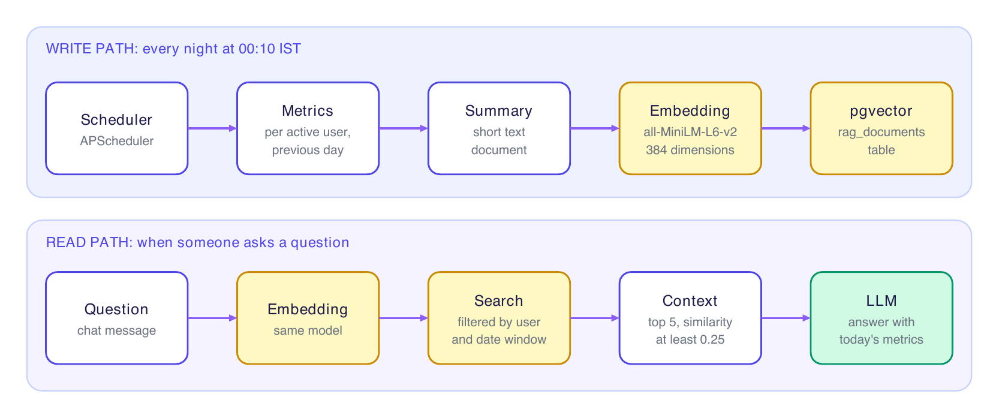

# AI implementation

This document covers how FocusGuard AI turns activity numbers into recommendations and chat answers: the LLM provider layer, the prompts, and the RAG pipeline that gives the assistant a memory.

## LLM providers

`app/services/llm.py` wraps three providers behind one call, `llm_service.ask_llm(prompt)`.

| Provider | Needs | Notes |
|----------|-------|-------|
| Groq | `GROQ_API_KEY` | Default. Low temperature (0.4) and a token cap that keeps organization insights from being cut off mid-sentence. |
| Gemini | `GEMINI_API_KEY` | First fallback when Groq is preferred. |
| OpenAI | `OPENAI_API_KEY` | Optional. |

Model names and generation settings are set in `llm.py`, so change them there.

### Provider order

`DEFAULT_LLM` chooses who goes first. The others follow in a fixed order.

| `DEFAULT_LLM` | Order tried |
|---------------|-------------|
| `groq` | Groq, Gemini, OpenAI |
| `gemini` | Gemini, Groq, OpenAI |
| anything else | OpenAI, Groq, Gemini |

A provider without an API key raises an error that is caught, so the loop moves on to the next one. If every provider fails, the API router turns the failure into HTTP 503 with a short "assistant temporarily unavailable" message and logs the cause on the server.

### System prompt

Every provider gets the same system instruction. It tells the model to act as FocusGuard AI, give concise and practical advice, use only the data in the prompt, never invent statistics, causes, trends or features, keep historical dates exactly as given, and finish with complete sentences.

To add a provider, write an `_ask_<name>` method in `LLMService` and add it to the lists in `ask_llm`.

## Recommendations

Endpoints: `GET /ai/recommendation?period=today|week|month` for a user, and `GET /ai/organization-recommendation` for organization-level insight.

1. The analytics service computes the metrics for the requested period.
2. For `today`, if there is no activity at all, the endpoint returns a fixed message and does not call the LLM. This avoids asking a model to interpret zero data. Week and month periods still run the normal flow.
3. Relevant history is retrieved from RAG for the matching window (see below).
4. `app/services/prompts.py` builds the prompt: one template each for daily, weekly (last 7 days) and monthly (last 30 days) advice.
5. The LLM answer is returned with the metrics it was based on, so the dashboard can show both.

The prompt templates share a block of data rules. They forbid inventing numbers, arbitrary targets (such as "30 minutes") and unsupported trends. They say that active, browser and productive time are separate metrics. They tell the model to say so when there is not enough data, and not to claim the user "did not work" just because FocusGuard recorded little. Advice is limited to practical themes such as reducing tab switching, keeping focus during sessions, spending more time on productive sites and reducing idle periods.

## Chat assistant

`POST /ai/chat` takes `{ "message": "...", "history": [{ "sender": "...", "text": "..." }] }` and returns `{ "response": "..." }`.

The prompt combines four things:

1. The question.
2. Today's metrics for the user (authoritative for current activity).
3. Historical context retrieved from RAG, when there is any.
4. The recent conversation from `history`, so follow-up questions make sense.

There is no keyword filter on questions. Topic limits are enforced by the chat prompt itself, because a keyword pre-check rejected valid questions such as "How can I improve?" and anything not written in English.

## RAG pipeline



### Write path

APScheduler runs `run_daily_rag_ingestion` every day at 00:10 in the Asia/Kolkata time zone (`app/services/rag/scheduler.py`).

1. Pick active users with the `USER` role. Skip anyone with no active, idle or browser time on the target date.
2. Compute that day's metrics with `get_dashboard_metrics_for_date`.
3. Write a text summary with `build_daily_summary_document`:

   ```
   FocusGuard Daily Productivity Summary
   Date: 2026-10-30

   Productivity Metrics:
   Focus score: ...
   Browser time: ...
   Active time: ...
   Idle time: ...
   Productive time: ...
   Non-productive time: ...
   Tab switches: ...

   Top websites: ...
   Top categories: ...
   Productive websites: ...
   Distracting websites: ...
   ```

4. Embed the text with `all-MiniLM-L6-v2` (normalized, 384 dimensions) and upsert it into `rag_documents`.
5. Organization-level summaries are written the same way for Sub Admin and Super Admin questions.

Document types stored in `rag_documents`: `daily_summary`, `organization_daily_summary`, `website_summary` and `category_summary`. Each row carries `user_id`, `organization_id`, the document text, the embedding and a metadata object that includes the date.

To fill the table for days that already exist, create it first and then backfill:

```bash
python create_rag_table.py
python backfill_rag.py
```

`app/scripts/` has more helpers: `backfill_user_rag.py`, `backfill_organization_rag.py` and `rebuild_user_rag.py`.

### Read path

1. Embed the question (or a query built from it) with the same model.
2. Search `rag_documents` by vector similarity. The user or organization filter, the document type and the date window are part of the SQL query, so another person's rows are never fetched.
3. Keep up to 5 documents with similarity of at least 0.25.
4. `build_rag_context` formats each as a block with its type, historical date and similarity score (3000 characters at most per document), under rules that say: this is historical information, not today's analytics; keep dates exactly; use it only when relevant; do not invent trends.
5. The block is appended to the prompt, together with a reminder that today's metrics win over anything historical.

### Date windows

Current analytics and retrieved history never overlap.

| Request | Current data | History retrieved from |
|---------|--------------|------------------------|
| Chat, or recommendation for `today` | Today | Today minus 30 days through yesterday |
| Recommendation for `week` | Rolling last 7 days | The 7 days before that (today minus 14 through today minus 8) |
| Recommendation for `month` | Rolling last 30 days | The 30 days before that (today minus 60 through today minus 31) |

### Configuration

| Setting | Value | Where |
|---------|-------|-------|
| Embedding model | `all-MiniLM-L6-v2` | `app/services/rag/embeddings.py` |
| Vector size | 384, enforced by the vector store | `vector_store.py`, `models.RAGDocument` |
| Schedule | Daily at 00:10, Asia/Kolkata | `scheduler.py` |
| Documents per query | 5 | `ai.py` |
| Minimum similarity | 0.25 | `rag_service.retrieve_context` |
| Characters per document | 3000 | `context_builder.py` |

## Translation

Sarvam AI translates interface text and dynamic messages (`app/services/sarvam_service.py`, `translation_service.py`). Results are cached in `translations` and `dynamic_translations`. Planner messages and notifications are translated to the user's preferred language before they are returned.

## Testing the AI layer

The `qa/rag_tests.py` script checks vector storage, retrieval, historical context and organization scoping, and `qa/seed_demo.py` creates data to try recommendations and chat against. Provider fallback can be checked by unsetting `GROQ_API_KEY` and confirming that Gemini answers.
