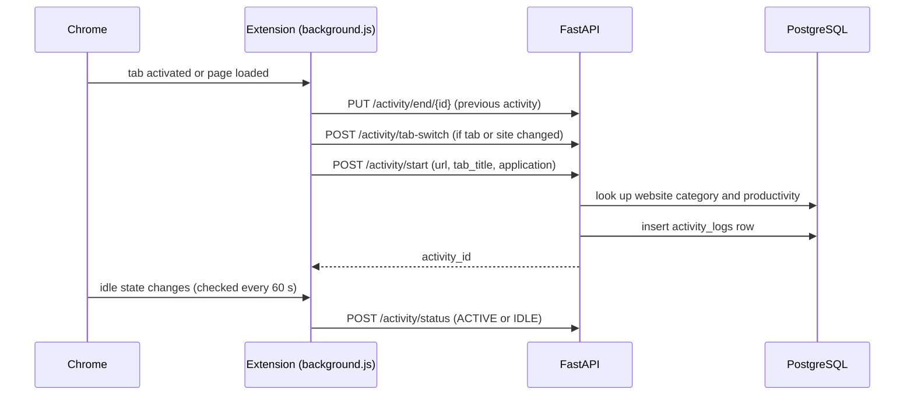
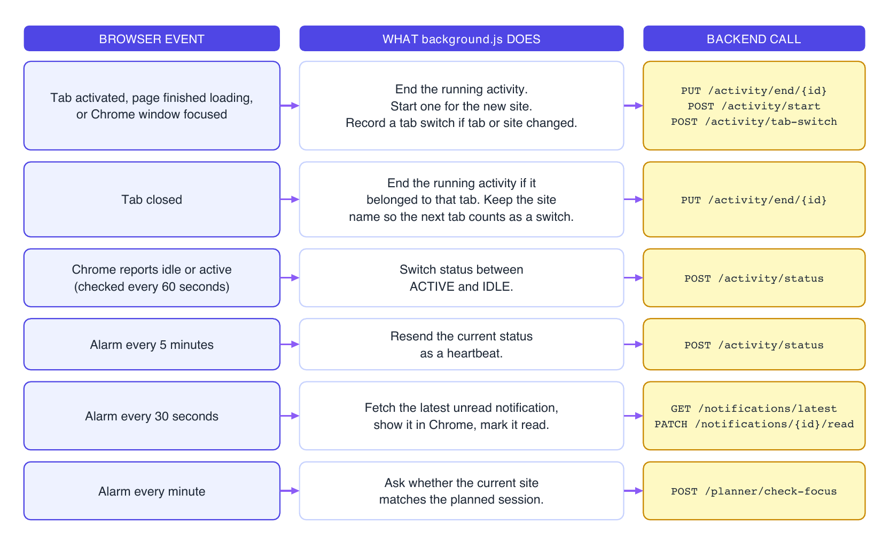
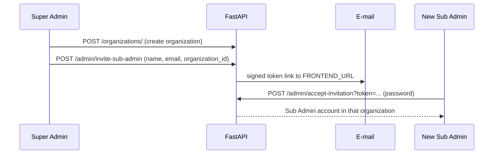
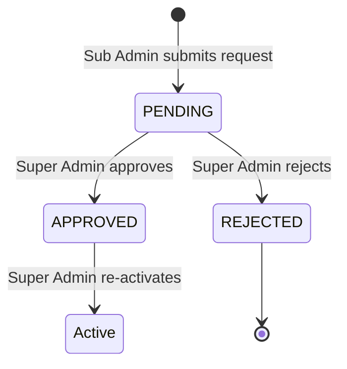

# Architecture

FocusGuard AI is a client-server system. Two clients, a Chrome extension and a React dashboard, talk to one FastAPI backend over REST. The backend owns all data and every call to an outside AI service.

## Components

| Component | Built with | Responsibility |
|-----------|-----------|----------------|
| Chrome extension | Manifest V3, JavaScript service worker | Records activity, tab switches and idle status. Shows Chrome notifications. Checks planner focus. Has its own sign-in popup. |
| Web dashboard | React 19, TypeScript, Vite, Tailwind CSS | Role-specific dashboards, analytics, planner, AI insights, chat, reports and settings. |
| Backend API | Python, FastAPI, SQLAlchemy, Uvicorn | Authentication, role checks, analytics, planner, notifications, AI endpoints and translation. |
| Database | PostgreSQL with pgvector | Application data and RAG embeddings. |
| AI layer | Groq, Gemini, OpenAI (optional) | Writes recommendations and chat replies. |
| Embeddings | `all-MiniLM-L6-v2` | Turns daily summaries into 384-dimension vectors. |
| Translation | Sarvam AI | Translates interface text and dynamic messages. |

## How the parts communicate

- All traffic is REST with JSON bodies. Protected endpoints expect `Authorization: Bearer <access token>`.
- Access tokens are short-lived JWTs. A refresh token obtains a new access token through `POST /auth/refresh-token`. Lifetimes come from `ACCESS_TOKEN_EXPIRE_MINUTES` and `REFRESH_TOKEN_EXPIRE_DAYS`.
- CORS origins come from `CORS_ORIGINS`. Setting `CHROME_EXTENSION_ID` adds the extension's origin.
- The extension reads its backend address from `chrome_extension/config.js`. `USE_LOCAL_BACKEND = true` selects `http://127.0.0.1:8000`, and `false` selects the hosted backend.
- Outside AI calls (Groq, Gemini, OpenAI, Sarvam) happen only in the backend, so API keys never reach a browser.

## Backend startup

`app/main.py` does three things when the application starts:

1. Creates any missing tables with SQLAlchemy.
2. Seeds the default website categories.
3. Starts the APScheduler job that writes the nightly RAG summaries (00:10, Asia/Kolkata).

## Activity tracking flow

The service worker keeps its tracking state in `chrome.storage`, because Chrome stops an idle worker after about 30 seconds and plain variables would be lost. Events run through a queue, one at a time, so tab activation, page load and window focus events that fire together do not create duplicate activities.

Rules the extension follows:

- Pages such as `chrome://` and the new-tab page are not tracked. Visiting one stops the timer, so its time is not credited to the previous site.
- A tab switch is a change of tab or of website. Moving between pages of one site in one tab does not count.
- Website names come from the hostname (for example `github.com`), because page titles change while a page loads and would create switches that never happened.
- When a tracked tab closes, the running activity ends. The site name is kept so the next tab counts as a switch.

### Timers in the extension

| Alarm | Period | Action |
|-------|--------|--------|
| Status heartbeat | 5 minutes | Resend the current ACTIVE or IDLE status |
| Notifications | 30 seconds | Fetch the latest unread notification, show it in Chrome, mark it read |
| Planner focus | 1 minute | Call `POST /planner/check-focus` |

## Analytics

`app/services/analytics_service.py` computes metrics for a period (today, week or month) from `activity_logs`, `user_status_logs` and `tab_switch_logs`.

| Metric | Meaning |
|--------|---------|
| Active and idle time | Time in each status, from the events the extension sends |
| Browser time | Total time on tracked websites |
| Productive and non-productive time | Browser time split by each site's productivity value |
| Focus score | `active / (active + idle) x 100`. Browser time is not used as the denominator. |
| Tab switches | Number of recorded tab or website changes |
| Top websites and categories | Where the time went, ranked |

## Planner and notifications

A user creates a plan for a day, with sessions that have a category, planned minutes and optional start and end times. `POST /planner/check-focus` compares the category of the latest activity with the session running now.

| Status | Meaning |
|--------|---------|
| `NO_PLAN` | No plan for today |
| `NO_SESSION` | A plan exists, but the current time is outside every session |
| `NO_ACTIVITY` | A session is running and no activity has been recorded |
| `ON_TRACK` | The latest activity matches the planned category |
| `OFF_TRACK` | The categories differ. The message names both and is translated to the user's language. |

Notification rules in `app/services/notification_rules.py` create `BREAK_REMINDER`, `NON_PRODUCTIVE_ACTIVITY` and `IDLE_ALERT` notifications. Organization workflows add `DEACTIVATION_APPROVED`, `DEACTIVATION_REJECTED` and `SUB_ADMIN_WELCOME`. The thresholds are currently 20 seconds each, which suits testing. Raise them for real use.

## Roles and organizations

| Role | Scope |
|------|-------|
| `SUPER_ADMIN` | Whole platform |
| `SUB_ADMIN` | One organization |
| `USER` | Own data |

The first account registered in an empty database becomes `SUPER_ADMIN` through `POST /auth/register`. After that, `POST /auth/register-user` creates plain `USER` accounts, and Sub Admins are created through invitations.

Role checks run in the backend on each endpoint. The dashboard also redirects every role to its own area (`/user`, `/subadmin`, `/superadmin`) and away from the others.

### Sub Admin invitation

The accept step refuses links that are expired, tampered with, already used, issued for another role, or pointing at a missing or inactive organization.

### Organization deactivation

Only one request can be pending at a time. Approval marks the organization inactive, which blocks its members at login and blocks invitations into it. Rejection leaves the organization running. Both decisions create notifications.

## Data model

| Table | Holds |
|-------|-------|
| `organizations` | Organizations and their active flag |
| `deactivation_requests` | Deactivation requests with reason and status |
| `users` | Name, e-mail, hashed password, age, occupation, role, organization, preferred language, active flag |
| `activity_logs` | One row per visit: URL, website, category, productivity, start, end, duration |
| `website_categories` | Domain to category and productivity lookup, seeded at startup |
| `tab_switch_logs` | From-website and to-website for each recorded switch |
| `user_status` | Current ACTIVE or IDLE status per user |
| `user_status_logs` | Status history |
| `notifications` | Per-user title, message, type and read state |
| `focus_plans` | One plan per user per day with a total goal in minutes |
| `focus_plan_items` | Sessions inside a plan: category, planned minutes, start, end |
| `translations` | Cached interface translations |
| `dynamic_translations` | Cached translations of dynamic messages |
| `rag_documents` | Daily summaries with user, organization, date and a 384-dimension embedding |

## Deployment notes

- Local ports are 8000 for the backend and 5173 for the dashboard. `focusguard.sh` starts PostgreSQL, the backend and the frontend together on macOS.
- The code references a Vercel frontend and a Render backend for hosted use. The extension's `host_permissions` include the local addresses and the hosted backend.
- Set `FRONTEND_URL` so invitation e-mails link to the right address, and `SUPPORT_EMAIL` for the contact address shown in e-mails and errors.
